<!-- Generated by scripts/render.py from data/. Edit the data, not this file. -->

<a href="https://wuxy1997.github.io/"><picture><source media="(prefers-color-scheme: dark)" srcset="assets/hero-id-dark.svg"><source media="(prefers-color-scheme: light)" srcset="assets/hero-id-light.svg"></picture></a>
<a href="https://wuxy1997.github.io/"><picture><source media="(prefers-color-scheme: dark)" srcset="assets/hero-core-dark.svg"><source media="(prefers-color-scheme: light)" srcset="assets/hero-core-light.svg"></picture></a>
 
<a href="https://github.com/Wuxy1997?tab=repositories"><picture><source media="(prefers-color-scheme: dark)" srcset="assets/stats-dark.svg"><source media="(prefers-color-scheme: light)" srcset="assets/stats-light.svg"></picture></a>
<picture><source media="(prefers-color-scheme: dark)" srcset="assets/langs-dark.svg"><source media="(prefers-color-scheme: light)" srcset="assets/langs-light.svg"></picture>
 
<picture><source media="(prefers-color-scheme: dark)" srcset="assets/loadout-dark.svg"><source media="(prefers-color-scheme: light)" srcset="assets/loadout-light.svg"></picture>
<a href="https://wuxy1997.github.io/about/"><picture><source media="(prefers-color-scheme: dark)" srcset="assets/fields-dark.svg"><source media="(prefers-color-scheme: light)" srcset="assets/fields-light.svg"></picture></a>
  
<a href="https://github.com/Wuxy1997?tab=repositories"><picture><source media="(prefers-color-scheme: dark)" srcset="assets/band-projects-dark.svg"><source media="(prefers-color-scheme: light)" srcset="assets/band-projects-light.svg"></picture></a>
 
<a href="https://github.com/Wuxy1997/AI-video"><picture><source media="(prefers-color-scheme: dark)" srcset="assets/project-storyboarder-dark.svg"><source media="(prefers-color-scheme: light)" srcset="assets/project-storyboarder-light.svg"></picture></a>
<a href="https://github.com/Wuxy1997/Federated-Reinforcement-Learning-for-Mobile-Edge-Computing-Rebuild-t"><picture><source media="(prefers-color-scheme: dark)" srcset="assets/project-frl-mec-dark.svg"><source media="(prefers-color-scheme: light)" srcset="assets/project-frl-mec-light.svg"></picture></a>
<a href="https://github.com/Wuxy1997/SARS-CoV-2-AI-Analyzer"><picture><source media="(prefers-color-scheme: dark)" srcset="assets/project-sars-analyzer-dark.svg"><source media="(prefers-color-scheme: light)" srcset="assets/project-sars-analyzer-light.svg"></picture></a>
<a href="https://github.com/Wuxy1997/Alicloud-oss-last-edited-time-sort-and-batch-move"><picture><source media="(prefers-color-scheme: dark)" srcset="assets/project-oss-manager-dark.svg"><source media="(prefers-color-scheme: light)" srcset="assets/project-oss-manager-light.svg"></picture></a>
<a href="https://github.com/Wuxy1997/PDFsplitmerger"><picture><source media="(prefers-color-scheme: dark)" srcset="assets/project-pdf-splitter-dark.svg"><source media="(prefers-color-scheme: light)" srcset="assets/project-pdf-splitter-light.svg"></picture></a>
<a href="https://github.com/Wuxy1997/Com6102gp5"><picture><source media="(prefers-color-scheme: dark)" srcset="assets/project-health-tracker-dark.svg"><source media="(prefers-color-scheme: light)" srcset="assets/project-health-tracker-light.svg"></picture></a>
  
<a href="https://wuxy1997.github.io/archives/"><picture><source media="(prefers-color-scheme: dark)" srcset="assets/band-log-dark.svg"><source media="(prefers-color-scheme: light)" srcset="assets/band-log-light.svg"></picture></a>
 
<a href="https://wuxy1997.github.io/2026/01/07/2026-01-07-typescript-vue3-best-practices/"><picture><source media="(prefers-color-scheme: dark)" srcset="assets/log-0-dark.svg"><source media="(prefers-color-scheme: light)" srcset="assets/log-0-light.svg"></picture></a>
<a href="https://wuxy1997.github.io/2026/01/07/2026-01-07-federated-reinforcement-learning-project/"><picture><source media="(prefers-color-scheme: dark)" srcset="assets/log-1-dark.svg"><source media="(prefers-color-scheme: light)" srcset="assets/log-1-light.svg"></picture></a>
<a href="https://wuxy1997.github.io/2026/01/07/2026-01-07-python-efficiency-tips/"><picture><source media="(prefers-color-scheme: dark)" srcset="assets/log-2-dark.svg"><source media="(prefers-color-scheme: light)" srcset="assets/log-2-light.svg"></picture></a>
<a href="https://wuxy1997.github.io/2026/01/07/2026-01-07-alicloud-oss-tool/"><picture><source media="(prefers-color-scheme: dark)" srcset="assets/log-3-dark.svg"><source media="(prefers-color-scheme: light)" srcset="assets/log-3-light.svg"></picture></a>
<a href="https://wuxy1997.github.io/2026/01/06/2026-01-07-federated-learning-edge-computing/"><picture><source media="(prefers-color-scheme: dark)" srcset="assets/log-4-dark.svg"><source media="(prefers-color-scheme: light)" srcset="assets/log-4-light.svg"></picture></a>
<a href="https://wuxy1997.github.io/2026/01/06/2026-01-07-my-open-source-projects/"><picture><source media="(prefers-color-scheme: dark)" srcset="assets/log-5-dark.svg"><source media="(prefers-color-scheme: light)" srcset="assets/log-5-light.svg"></picture></a>
  
<picture><source media="(prefers-color-scheme: dark)" srcset="assets/foot-motto-dark.svg"><source media="(prefers-color-scheme: light)" srcset="assets/foot-motto-light.svg"></picture>
<a href="https://wuxy1997.github.io/about/"><picture><source media="(prefers-color-scheme: dark)" srcset="assets/foot-credit-dark.svg"><source media="(prefers-color-scheme: light)" srcset="assets/foot-credit-light.svg"></picture></a>

